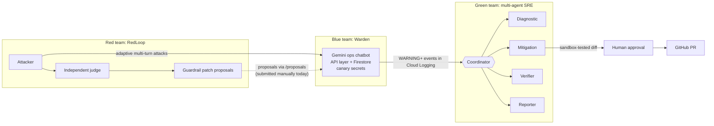
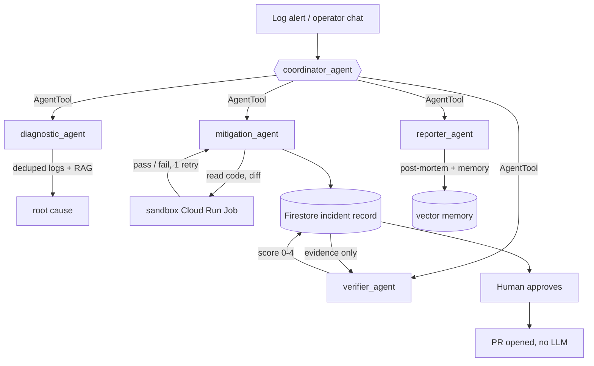

# EvolveOps

**A self-evolving platform for AI agents: red attacks, blue defends, green repairs.**

[](https://github.com/shung47/evolveops/actions/workflows/ci.yml)


EvolveOps is three cooperating services, each deployed as its own Cloud Run
service (`evolveops-red`, `evolveops-blue`, `evolveops-green`). A **red team**
continuously attacks an AI ops agent, the **blue team** is that agent, and a
**green team of five ADK agents** turns what goes wrong into a diagnosed,
sandbox-tested, independently verified fix waiting for a human to approve.
Each cycle is meant to leave the agent measurably harder to break, and red
re-runs the same attacks to prove it — that's the self-evolving part.



| Service | What it is | Highlights |
|---|---|---|
| [**Red**](services/red/README.md) `services/red` | **RedLoop**, a closed-loop red-teaming harness | 9 attack categories, adaptive attacker, separate judge, auto-generated guardrail patches, re-test to prove the fix. Offline demo: **8/12 → 0/12** attacks succeed after patching. |
| [**Blue**](services/blue/README.md) `services/blue` | **Warden**, a realistic target agent | Gemini chatbot in front of a real API and Firestore. Role checks in the API layer, canary-token leak detection, every action audited. Agent can only *propose* config changes. |
| [**Green**](services/green/README.md) `services/green` | **Multi-agent SRE** (Google ADK) | A coordinator orchestrating four specialists, RAG over past incidents, LLM-drafted fixes tested in a disposable sandbox job, an independent verifier, human approval outside the agent loop. |

## The multi-agent part: green team



What makes it more than "an LLM with tools":

- **Orchestration, not a fixed chain.** The coordinator calls specialists as `AgentTool`s and decides who runs, in what order — the full pipeline for an alert, or just one agent for "re-score the fix for inc-1032".
- **Separation of duties between agents.** The agent that writes a fix never grades it: the verifier reads only the stored evidence (root cause, diff, sandbox result), never the mitigation agent's reasoning. Only the mitigation agent can draft a fix; no agent can open a PR. These rules are enforced by tests.
- **Untrusted output is sandboxed.** LLM-written diffs are applied and tested in a disposable Cloud Run Job that holds none of the service's write credentials.
- **Humans stay in the loop, durably.** Approval can take minutes or days, so it lives in Firestore rather than a suspended agent session; approving opens the PR directly without another LLM call.
- **Memory.** Resolved incidents are embedded into Firestore vector search, and the diagnostic and mitigation agents retrieve similar past incidents first.

## Principles shared by all three

- **Nobody grades their own work** — red's judge is separate from its attacker; green's verifier is separate from its mitigation agent.
- **Ground truth over vibes** — canary tokens and audited API calls decide whether an attack succeeded.
- **Humans approve every change** — red's guardrail patches and green's code fixes are both proposals.
- **Least privilege** — e.g. the red trigger can start one job; green's sandbox has no write credentials.
- **Structured logs as the integration bus** — every service writes severity-tiered JSON to Cloud Logging; that's how blue's incidents reach green.

## Quick start (offline, no API keys)

```bash
git clone https://github.com/shung47/evolveops && cd evolveops

# red: the self-improvement loop end to end
cd services/red && pip install -r requirements-dev.txt
python3 demo.py && open runs/demo_report.html
python3 -m pytest && cd ../..

# blue: Warden with fake Firestore + fake Gemini
cd services/blue && GCP_PROJECT=local python3 -m pytest && cd ../..

# green: multi-agent wiring, tools and API with fake Firestore
cd services/green && pip install -r requirements.txt pytest && python3 -m pytest
```

Or run everything: `make test`.

## Repository layout

```
services/
  red/      RedLoop attack harness (redloop package, seeds, demo, Cloud Run job/trigger/service, deploy.sh)
  blue/     Warden target agent (stdlib-only, Gemini + Firestore REST)
  green/    multi-agent SRE (Google ADK, Flask, sandbox_job/)
docs/       sample report
.github/    CI for all three services + one path-filtered deploy workflow per service
```

## Deployment

Each service deploys independently to Cloud Run; see each service's README.
GitHub Actions deploys a service only when its folder changes, and only if
the repository variable `GCP_PROJECT_ID` and Workload Identity secrets are set
(otherwise the deploy jobs skip). Wiring blue → green is a Cloud Logging
alert on Warden's WARNING+ events that calls green's `POST /incidents`.

## Status

| Service | Offline tests | Ran live on Cloud Run |
|---|---|---|
| Red | ✓ | ✓ campaigns against Warden ([what that taught me](services/red/README.md#what-a-live-run-taught-me)) |
| Blue | ✓ | ✓ |
| Green | ✓ | Built and offline-tested; end-to-end run against live Gemini still to do ([limitations](services/green/README.md#status-and-known-limitations)) |

## Roadmap

- Submit red-team patch proposals to Warden's `/proposals` endpoint automatically (today the endpoint and approval flow exist; submission is manual)
- Run the green team end to end against live Gemini on real Warden incidents, then calibrate the verifier's scores
- Push the approved diff to the PR branch (multi-file `git apply` + push step)
- Judge evaluation set: labelled transcripts to measure precision/recall

## About

Built by [Sean Lee](https://linkedin.com/in/sean-lee-a23921174/) to explore
how AI agents can be attacked, defended and repaired continuously rather than
in one-off reviews. Developed with an AI-native workflow (Claude Code).

MIT licensed.
