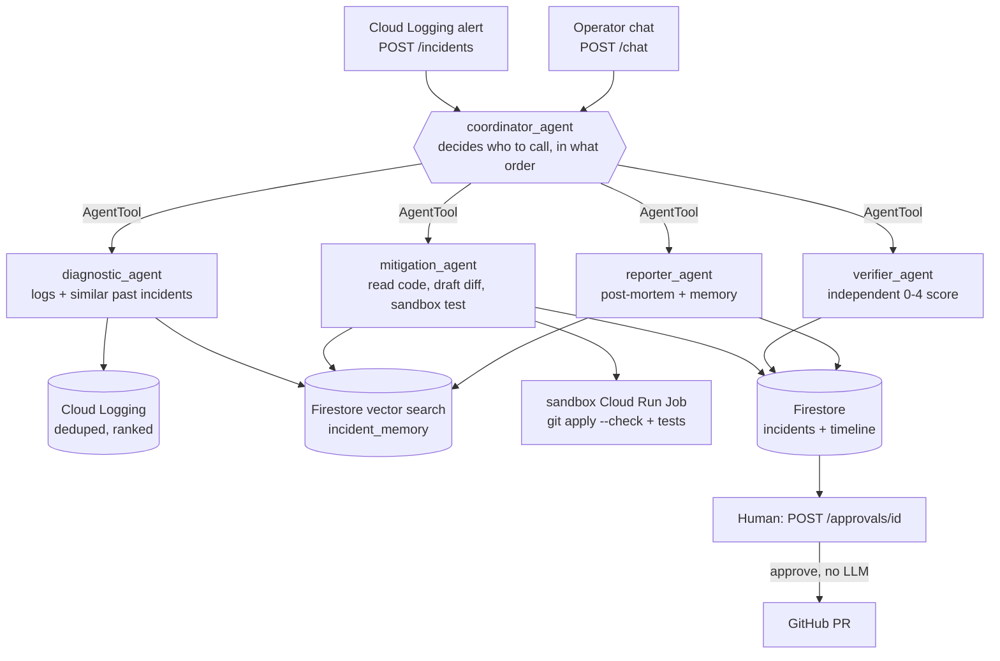

# Green team — multi-agent SRE

A **coordinator agent** and **four specialist agents** (Google ADK + Gemini)
that pick up an incident, find the root cause, draft and sandbox-test a fix,
have it **independently verified**, and hand it to a human for approval. In
EvolveOps it watches Warden (the blue team): when an attack trips a WARNING+
event in Warden's logs, a Cloud Logging alert opens a green-team incident.

## Architecture



| Agent | Tools | Responsibility |
|---|---|---|
| `coordinator_agent` | the four agents below, as `AgentTool`s | Single entry point for automatic alerts and free-form operator requests. Runs the full pipeline for alerts; calls only what's needed for ad-hoc requests. |
| `diagnostic_agent` | `search_similar_incidents`, `fetch_incident_logs` | Root cause from logs, checking past incidents first. |
| `mitigation_agent` | `search_similar_incidents`, `read_repo_file`, `propose_patch`, `run_sandbox_test`, `request_human_approval` | Minimal fix as a unified diff, tested in an isolated sandbox, one retry on failure, then hand-off. |
| `verifier_agent` | `get_incident`, `get_timeline`, `record_verification_score` | Scores the fix 0–4 from the stored evidence only. |
| `reporter_agent` | `get_timeline`, `record_incident_memory` | Post-mortem, plus a short memory for future retrieval (resolved incidents only). |

## Design decisions

- **`AgentTool`, not `sub_agents` or a fixed chain.** The coordinator stays in
  control and chooses which specialists to call, so the same agent serves both
  the automatic pipeline and "re-run diagnosis on inc-1032" style requests.
- **The agent that writes a fix never grades it.** `verifier_agent` gets only an
  incident ID and reads the root cause, diff and sandbox result from Firestore
  itself; it never sees `mitigation_agent`'s reasoning. Same principle as the
  red team's separate judge.
- **LLM-written code runs in a disposable sandbox.** Applying a generated diff
  and running tests is arbitrary code execution, so it runs as a separate Cloud
  Run Job without the service's Firestore/GitHub write credentials.
- **Approval happens outside the agent loop.** ADK's long-running-tool pattern
  would need the session to survive a wait of minutes to days. Instead the
  mitigation agent writes the drafted fix to Firestore and ends its turn;
  `POST /approvals/<id>` opens the PR directly, with no LLM call.
- **Least capability per agent.** Only `mitigation_agent` can draft or test a
  fix; no agent can open a PR (enforced by tests in `tests/test_green.py`).
- **Cost control before the LLM.** Log entries are deduplicated and ranked
  (`x500 same stack trace` becomes one line) before they reach the model.
- **RAG without another database.** Incident memory uses Firestore's native
  vector search (`find_nearest`) with a multilingual embedding model.

## API

All routes except `/healthz` require `Authorization: Bearer $GREEN_TEAM_TOKEN`.

```bash
# automatic trigger (Cloud Logging alert -> Eventarc)
curl -X POST "$GREEN_URL/incidents" -H "Authorization: Bearer $GREEN_TEAM_TOKEN" \
  -H "Content-Type: application/json" \
  -d '{"service": "evolveops-blue", "title": "secret_leaked events", "severity": "critical"}'

# operator request
curl -X POST "$GREEN_URL/chat" -H "Authorization: Bearer $GREEN_TEAM_TOKEN" \
  -H "Content-Type: application/json" -d '{"message": "re-score the fix for inc-1032"}'

# approve / reject (no LLM involved)
curl -X POST "$GREEN_URL/approvals/inc-1032" -H "Authorization: Bearer $GREEN_TEAM_TOKEN" \
  -H "Content-Type: application/json" -d '{"decision": "approve", "approver": "sean"}'
```

## Configuration

| Variable | Purpose |
|---|---|
| `GREEN_TEAM_TOKEN` | Bearer token for the API |
| `GOOGLE_CLOUD_PROJECT` | Firestore / Cloud Logging / Vertex AI project |
| `GREEN_TEAM_MODEL` | Optional, default `gemini-3.6-flash` |
| `GITHUB_TOKEN`, `GITHUB_REPO` | Read source and open PRs (`owner/name`) |
| `REGION`, `SANDBOX_JOB_NAME` | Where the sandbox job lives (default `evolveops-green-sandbox`) |
| `GREEN_TEAM_EMBEDDING_MODEL`, `GOOGLE_CLOUD_LOCATION` | Embedding model for RAG (default `text-multilingual-embedding-002`, `us-central1`) |

The sandbox job (`sandbox_job/`) takes `GOOGLE_CLOUD_PROJECT`, `GITHUB_TOKEN`,
`GITHUB_REPO`, optional `TEST_COMMAND` (e.g. `pytest -q`; without it only
`git apply --check` runs) and optional `TEST_REF` (default `main`).

## Deploy

```bash
gcloud run deploy evolveops-green --source services/green \
  --project "$PROJECT_ID" --region "$REGION" --allow-unauthenticated \
  --set-env-vars GOOGLE_CLOUD_PROJECT=$PROJECT_ID,GOOGLE_GENAI_USE_VERTEXAI=TRUE,REGION=$REGION,GITHUB_REPO=owner/name \
  --set-secrets GREEN_TEAM_TOKEN=evolveops-green-token:latest,GITHUB_TOKEN=github-token:latest

gcloud run jobs deploy evolveops-green-sandbox --source services/green/sandbox_job \
  --project "$PROJECT_ID" --region "$REGION" \
  --set-env-vars GOOGLE_CLOUD_PROJECT=$PROJECT_ID,TEST_COMMAND="pytest -q",GITHUB_REPO=owner/name \
  --set-secrets GITHUB_TOKEN=github-token:latest

# let the service start only that one job
gcloud run jobs add-iam-policy-binding evolveops-green-sandbox --region "$REGION" \
  --member "serviceAccount:<green service account>" --role roles/run.invoker

# RAG needs a vector index (768 dims for the default embedding model)
gcloud firestore indexes composite create --collection-group=incident_memory \
  --query-scope=COLLECTION \
  --field-config field-path=embedding,vector-config='{"dimension":"768","flat":{}}' \
  --project="$PROJECT_ID"
```

Until the index exists, `search_similar_incidents` returns an error string and
the agents continue without past incidents.

## Tests

```bash
pip install -r requirements.txt pytest
python -m pytest     # fake Firestore, no LLM/GCP/GitHub calls
```

The tests cover the tool layer (approval only after a drafted fix, score range
checks, log dedup), the multi-agent wiring (coordinator → four specialists,
verifier independence, no agent can open a PR) and the HTTP API (auth,
approve/reject without an LLM call).

## Status and known limitations

- **Not yet validated end to end against live Gemini.** Agent construction and
  the tool/API layers are tested offline; prompt behaviour, diff quality and
  verifier calibration still need real incidents.
- **PR commit step is not implemented.** `open_pull_request` opens the PR but
  doesn't yet push the diff to the branch; multi-file diffs need a clone +
  `git apply` + push step (see the docstring in `tools_code.py`).
- **Verifier scores are uncalibrated** — use them as information for the human
  approver, not as an automatic gate.
- **Sandbox isolation is container-level**; add VPC egress controls for
  untrusted test commands.
- `run_sandbox_test` polls synchronously for up to 90s, and
  `InMemorySessionService` doesn't share `/chat` history across instances.
