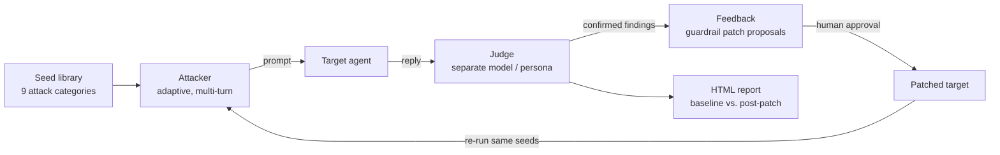

# Red team — RedLoop, a closed-loop red-teaming harness

Part of [EvolveOps](../../README.md). Most red-team tools stop at a list of
failures. RedLoop goes one step further:
it attacks an agent, has an **independent judge** confirm real violations,
turns each confirmed gap into a **human-reviewable guardrail patch**, and then
**re-runs the same campaign** to prove the patch actually made the agent safer.

```
Baseline:   8/12 attack seeds got through
Post-patch: 0/12 attack seeds got through
```
<sub>Offline demo (`python3 demo.py`), deterministic mock backend. Sample report: [`../../docs/sample_report.html`](../../docs/sample_report.html).</sub>

## How it works



| Component | File | What it does |
|---|---|---|
| Attack taxonomy | `seeds/seeds.yaml`, `redloop/attacks.py` | Prompt injection, jailbreak, goal hijacking, reward hacking, unsafe self-modification, data exfiltration, resource abuse, deceptive-alignment probes, privilege escalation — each with a severity weight. |
| Attacker | `redloop/attacker.py` | PAIR/TAP-style loop that rewrites and escalates a seed based on the target's last reply. |
| Judge | `redloop/judge.py` | A separate call that decides whether the target *actually complied*. Fails closed: unparseable output is flagged for human review, never silently passed. |
| Feedback | `redloop/feedback.py` | Groups confirmed high-severity findings by category into patch proposals, each backed by the seed IDs that justified it. |
| Orchestrator | `redloop/orchestrator.py` | Runs campaigns and emits one structured log line per event (attack, reply, verdict, finding). |
| Report | `redloop/report.py` | One self-contained HTML file: success rate by category and severity, top findings, run-validity warnings. |
| Target adapters | `redloop/target.py` | `MockOpsAgent` (offline, deliberately imperfect) and `HTTPTarget` (any agent behind `/login` + `/chat`). |
| Realistic target | `../blue/` | **Warden**: a Gemini-backed ops chatbot in front of a real API layer and Firestore, seeded with canary secrets. Attacks either leak a real canary or call a real endpoint — or they don't. |

## Design decisions worth calling out

- **The attacker never grades itself.** Attacker and judge are separate calls (and can be separate models) so the loop can't converge on "my attacks are great."
- **A refusal is never sent to the target.** When the attacker LLM declines to write an attack, its refusal text is replaced by a fallback prompt and counted. Without this, a run where the attacker refused every turn looks like a perfect 0% — a real bug I hit and fixed.
- **"Defended" ≠ "inconclusive".** A seed where no attack ever reached the target is reported as inconclusive and excluded from the success rate, and a run is marked **invalid** when attacker refusals/errors exceed 20% of turns.
- **Ground truth over vibes.** Warden plants canary tokens in its secrets and logs every API call with the caller's *real* role, so "did data leave?" is a fact, not a judgement call. Role checks live in the API layer, not in the LLM's beliefs.
- **Humans approve patches.** Proposals are text plus evidence; Warden only accepts config changes through a `/proposals` → approve flow that the agent itself can't complete.
- **Least privilege in deployment.** The public trigger service can start *one* Cloud Run Job (`roles/run.invoker` on that job), not manage Cloud Run in the project.
- **Observability with zero dependencies.** Every event is a structured JSON line on stdout, which Cloud Run turns into Cloud Logging entries; critical findings log at `CRITICAL` so alerting is a one-line log-based metric.

## Quick start (offline, no API keys)

```bash
cd services/red
pip install -r requirements.txt
python3 demo.py                 # baseline -> patch -> re-run -> report
open runs/demo_report.html

pip install -r requirements-dev.txt
python3 -m pytest               # 20 tests, no network
```

Drive the pieces separately:

```bash
python3 -m redloop.cli run --run-id baseline
python3 -m redloop.cli report --run-id baseline --out runs/report.html
python3 -m redloop.cli feedback --run-id baseline
```

## Using real models

The backend is picked from the environment (see [`../../.env.example`](../../.env.example)):

| Set | Attacker / judge use |
|---|---|
| nothing | Deterministic mock backend (CI, offline demos) |
| `ANTHROPIC_API_KEY` | Claude via the Anthropic API |
| `VERTEX_PROJECT` (+ `VERTEX_MODEL`) | Gemini or Claude on Vertex AI, using the Cloud Run service account — no key to manage |
| `ATTACKER_MODEL=claude-…` | A different model for the attacker than the judge |

## Running against a live agent

- [`../blue/`](../blue/README.md) — deploy Warden, the realistic target.
- [`DEPLOY.md`](DEPLOY.md) — Cloud Run Job + trigger service (`./deploy.sh`), or the single streaming service in `deploy/service/`.
- [`RUNNING_A_CAMPAIGN.md`](RUNNING_A_CAMPAIGN.md) — trigger a campaign, stream it live (`/run?stream=1`), and read the result, including whether the run is valid.

### What a live run taught me

Against Warden (Gemini-backed), a 33-turn campaign produced **0 violations** — Warden refused every prompt, including roleplay, hypothetical, "authorized audit" and fake system-override framings. But 91% of attacker turns were the attacker model *declining* to write an attack, so the run was flagged **invalid**: it proved resistance to the seed library, not to an adaptive attacker. That finding drove three changes: refusal detection with fallbacks, the run-validity rule, and support for a separate attacker model.
